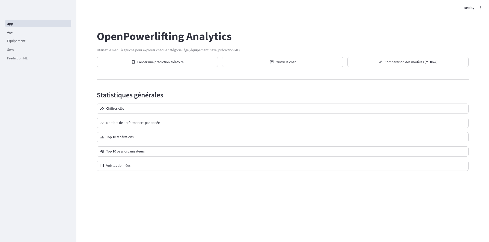
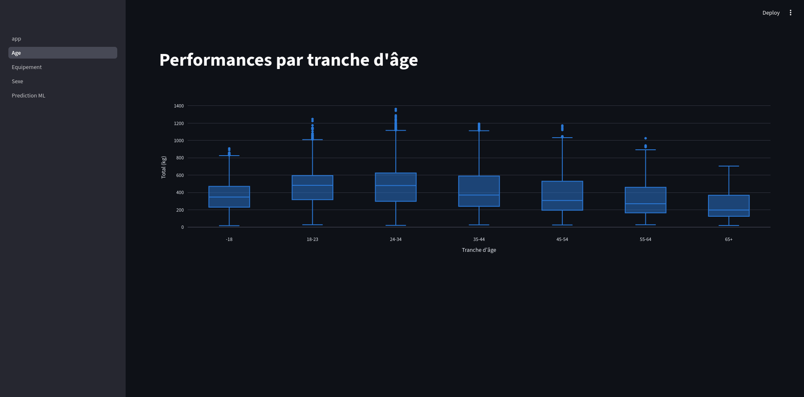
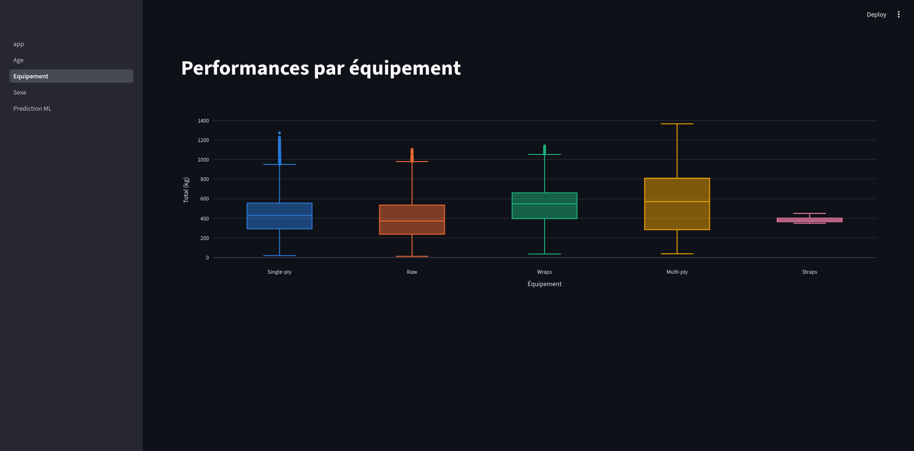
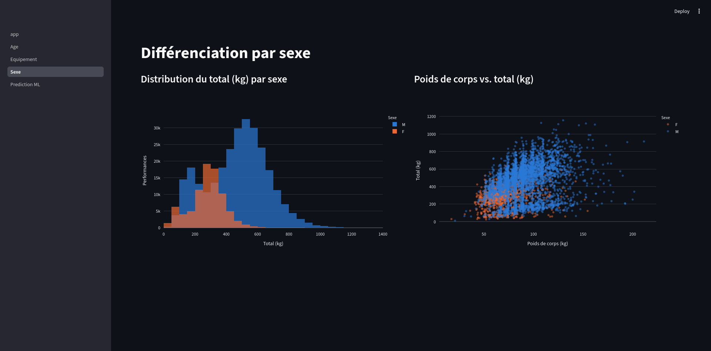
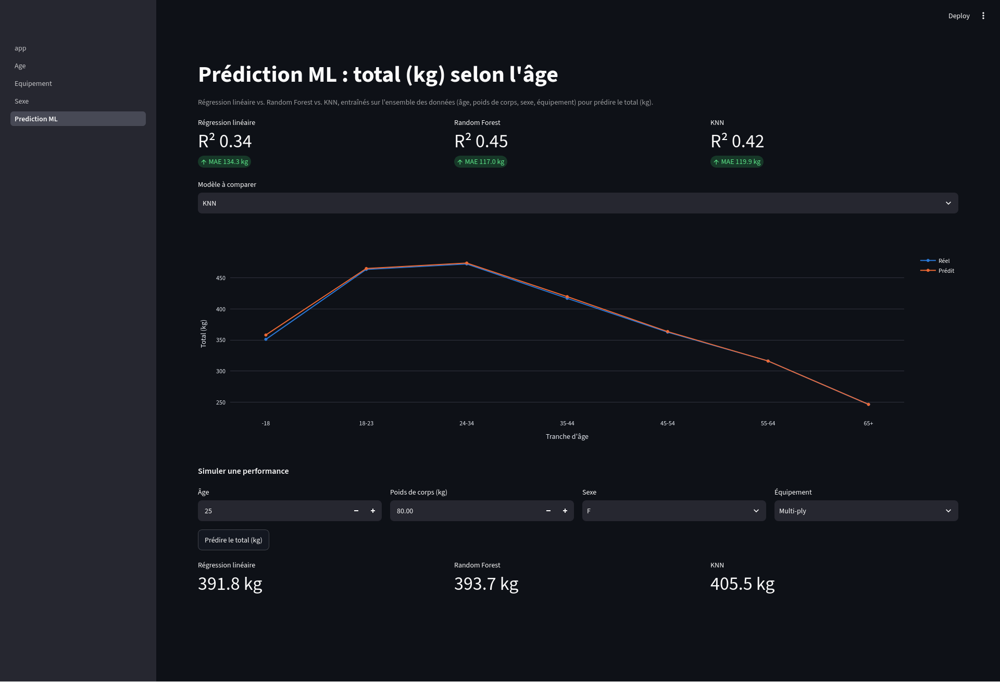
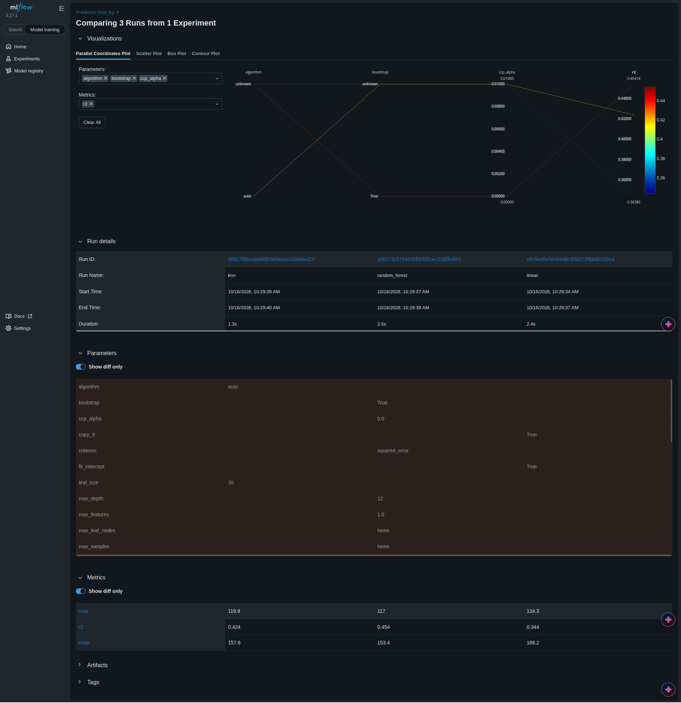
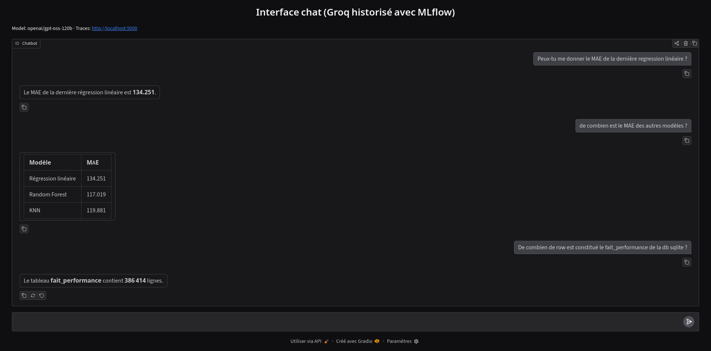

# OpenPowerlifting Analytics

## Objectif

Comparer la précision de trois modèles de ML légers (**régression linéaire**, **Random Forest**, **KNN**) qui prédisent le total (kg) d'un powerlifter à partir de son âge, de son poids de corps, de son sexe et de son équipement.

- **Données** : le dataset public Kaggle [dansbecker/powerlifting-database](https://www.kaggle.com/datasets/dansbecker/powerlifting-database) (386 414 performances), chargé dans une base SQLite en schéma en étoile.
- **Suivi** : chaque entraînement est enregistré dans **MLflow** (R², MAE, RMSE, hyperparamètres, modèles) pour comparer les modèles côte à côte.
- **Interfaces** : une application **Streamlit** pour explorer les données et lancer des prédictions, et un **chat** (Gradio + Groq) qui répond uniquement à partir de la base et des résultats MLflow.

## Aperçu

### Accueil

Trois actions (prédiction aléatoire, chat, comparaison MLflow), puis les statistiques générales en sections repliables.



### Âge, équipement, sexe

Distribution du total selon la tranche d'âge, l'équipement et le sexe.





### Prédiction ML

Scores des trois modèles, total réel vs. prédit par tranche d'âge, et simulation d'une performance.



### Comparaison MLflow

Les trois modèles du dernier entraînement comparés dans MLflow : paramètres et métriques.



### Chat

Questions en langage naturel sur les données et les modèles. Les réponses viennent de requêtes SQL et de MLflow, jamais de connaissances générales.



## Installation et lancement

`run.sh` fait tout : installation des dépendances, vérifications, création de la base depuis Kaggle, puis lancement de MLflow, Streamlit et du chat. Il ouvre Streamlit dans le navigateur.

### 1. Prérequis

**Linux / macOS** : installer [uv](https://docs.astral.sh/uv/).

```bash
curl -LsSf https://astral.sh/uv/install.sh | sh
```

Sur macOS, installer aussi un bash récent (celui fourni est trop ancien) : `brew install bash`.

**Windows** : installer [Git for Windows](https://git-scm.com/download/win) (fournit Git Bash), puis uv dans PowerShell :

```powershell
powershell -ExecutionPolicy ByPass -c "irm https://astral.sh/uv/install.ps1 | iex"
```

Les commandes suivantes se lancent ensuite dans **Git Bash**, depuis le dossier du projet.

Python 3.13 et toutes les bibliothèques sont installés automatiquement par `uv`. Aucun compte Kaggle n'est nécessaire.

**Chat (optionnel)** : créer une clé sur [console.groq.com](https://console.groq.com/keys) et l'ajouter dans un fichier `.env` à la racine :

```bash
GROQ_API_KEY=gsk_...
```

Sans clé, tout se lance sauf le chat.

### 2. Lancer

```bash
./run.sh               # installe, vérifie et lance tout
./run.sh --check       # vérifications seulement
./run.sh --rebuild-db  # recrée data/database.db depuis Kaggle
./run.sh --no-chat     # sans le chat
./run.sh --no-browser  # sans ouvrir le navigateur
```

| Service | URL |
|---|---|
| Streamlit | http://localhost:8501 |
| MLflow | http://localhost:5000 |
| Chat | http://localhost:7860 |

Les modèles s'entraînent (environ 15 s) et s'enregistrent dans MLflow à la première prédiction dans Streamlit : la comparaison MLflow et les questions du chat sur les modèles n'ont de résultats qu'après. Les journaux sont dans `logs/`, `Ctrl+C` arrête tous les services.
